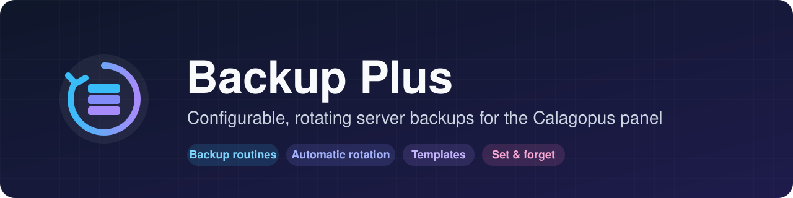
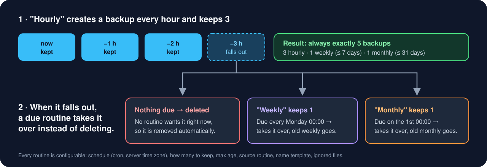

<p align="center">
  
</p>

<p align="center">
  <a href="https://github.com/Luis-1805/calagopus-backup-plus/releases/latest"></a>
  
  
  
  <a href="LICENSE"></a>
</p>

<p align="center">
  <b>Set up your backup strategy once — Backup Plus creates, rotates and cleans up your server backups for you.</b>
</p>

<p align="center">
  <a href="docs/README.md"><b>📖 Read the guide</b></a> ·
  <a href="docs/getting-started.md">🚀 Getting started</a> ·
  <a href="docs/tutorial.md">🎓 Tutorial</a> ·
  <a href="docs/recipes.md">🍳 Recipes</a> ·
  <a href="docs/troubleshooting.md">🛠️ Troubleshooting</a> ·
  <a href="https://github.com/Luis-1805/calagopus-backup-plus/releases/latest">⬇️ Download</a>
</p>

---

## Why Backup Plus?

The Calagopus panel can create backups, but keeping *the right ones* is up to you. Backup Plus turns backups into
**routines**: you decide when backups are made, how many of each kind to keep and how long to keep them. Everything
older is removed automatically, so you never run out of backup slots and never lose the backup you actually need.

A common setup, and the default template:

> **Always exactly 5 backups:** the last 3 hours, one from this week and one from this month.

## How rotation works

<p align="center">
  
</p>

Each routine keeps its newest backups. A routine of type **“take over”** doesn't create backups of its own: when a
backup falls out of its source routine *and* the routine is due according to its schedule, it takes that backup over
instead of letting it be deleted. That gives you weekly and monthly backups at no extra cost — and you can chain
routines (hourly → daily → weekly → monthly).

## Features

<table>
<tr>
<td width="50%" valign="top">

### 🗂️ Backup routines
- Any number of routines per server
- **Create** new backups or **take over** expiring ones
- Cron schedule in the server's time zone, with presets, a plain-language preview and the next run time
- Keep the newest *N*, optional maximum age
- Name template (`{routine}`, `{date}`, `{day}`, `{time}`, `{server}`) and ignored files per routine
- Pause, reorder or run a routine right now

</td>
<td width="50%" valign="top">

### 🔍 Full visibility
- See what happens to every backup on the next run: *stays*, *moves to routine X* or *will be deleted* (with reason)
- Per-routine status: backup count, last and next run, last error
- Run log per server, plus entries in the panel's activity log
- Admin overview: servers, routines, managed backups and storage used

</td>
</tr>
<tr>
<td valign="top">

### 🧩 Templates
- Ships with four ready-made templates (see below)
- Admins can create their own templates or copy a built-in one
- Apply a template to a single server, or to **all servers at once** — optionally only to servers that aren't set up yet

</td>
<td valign="top">

### 🛡️ Safe by design
- Uses its own backup group — **manual backups are never touched**
- **Pin** a backup and it is never deleted automatically
- Backups of paused or removed routines are kept
- Skips suspended, installing, restoring and transferring servers; never starts a backup while one is still running
- Validates schedules, minimum interval, routine chains (no cycles) and the server's backup limit

</td>
</tr>
<tr>
<td valign="top">

### ⚙️ Admin controls
- Global on/off switch
- Minimum interval between backups, max backups and routines per server
- **Allow or forbid custom routines** — when forbidden, users can only apply templates
- Default template for new servers
- Load balancing for large panels (servers processed per minute)

</td>
<td valign="top">

### 🔐 Permissions
- `backup-plus.read` — view routines, backups and the log
- `backup-plus.manage` — change routines, apply templates, run backups, pin backups
- Admin pages use the panel's `extensions.read` / `extensions.manage`

</td>
</tr>
</table>

> [!NOTE]
> 🌍 Available in **English** and **German**. The interface, error messages, the run log and the built-in template
> names follow each user's panel language. More languages can be added by dropping a JSON file into
> `frontend/public/translations/<language>/` (see [Translations](#translations)).

## Built-in templates

| Template | Routines | Backups kept |
| --- | --- | :---: |
| **GFS compact** *(default)* | 3 × hourly → 1 × weekly (renewed every Monday) and 1 × monthly (renewed on the 1st) | **5** |
| GFS extended | 24 × hourly → 7 × daily → 4 × weekly → 6 × monthly | 41 |
| Daily, 7 days | every night at 04:00, keep 7 | 7 |
| Every 6 hours, 2 days | every 6 hours, max. 48 hours old | 8 |

## Installation

> [!IMPORTANT]
> Installing extensions requires the Calagopus **`:heavy`** Docker image (or a development environment), because the
> panel compiles extensions on install. See the
> [Calagopus docs](https://calagopus.com/docs/panel/extensions/installing-extensions).

**Docker (`:heavy` image)**

1. Download `dev_backupplus_gfsbackups.c7s.zip` from the [latest release](https://github.com/Luis-1805/calagopus-backup-plus/releases/latest).
2. In the panel, go to **Admin → Extensions** and upload the file. The panel builds and loads it (usually 1–2 minutes).

**Development environment**

```bash
panel-rs extensions add dev_backupplus_gfsbackups.c7s.zip
panel-rs extensions apply --profile balanced
```

## Getting started

1. Make sure the server's **backup limit** is at least the total number of backups your routines keep — ideally one
   more, because a new backup briefly exists alongside the others until the next rotation a few minutes later.
2. Open the server and go to the new **Auto-Backups** tab.
3. Pick a template and click **Apply template** — or build your own routines and click **Save**.

That's it. The first backup is created within a minute, and from then on everything runs on its own.

> [!TIP]
> Want a weekly backup that is always *at least* a week old? Set the weekly routine to keep **2**.

## Documentation

The **[full guide](docs/README.md)** explains every feature in detail:

| | |
| --- | --- |
| 🚀 [Getting started](docs/getting-started.md) | Installation, backup limits, first setup |
| 🎓 [Tutorial](docs/tutorial.md) | **New to backups?** Build your own strategy step by step, with exercises |
| 💡 [Core concepts](docs/concepts.md) | Routines, "take over", rotation step by step, chains |
| 🗂️ [Routine reference](docs/routines.md) | Every setting, cron schedules, name templates, validation rules |
| 🖥️ [The Auto-Backups tab](docs/server-tab.md) | Status, setup, editor, backup list, log, permissions |
| 🧩 [Templates](docs/templates.md) | Built-in and custom templates |
| 🍳 [Recipes](docs/recipes.md) | Ready-to-use backup strategies |
| ⚙️ [Administration](docs/admin.md) | Global settings, bulk rollout, permissions, activity events |
| 🛠️ [Troubleshooting & FAQ](docs/troubleshooting.md) | Error messages, skipped backups, common questions |
| 🔌 [API](docs/api.md) | All endpoints with examples |
| 🔍 [How it works](docs/how-it-works.md) | Background task, algorithm, data model, translations |

## Upgrading from 1.x

Version 2 replaces the fixed hourly/daily/weekly/monthly tiers with free-form routines. Your existing settings are
migrated automatically into equivalent routines, and existing backups keep their assignment — no action needed.

## Development

- **Backend:** Rust. A cron task (`backup_plus_tick`) runs every minute on the primary instance and uses the panel's own
  models (`ServerBackup::create` / `delete`, `ServerBackupGroup`), so it works with every backup storage driver
  (local, S3, restic, Kopia, …).
- **Frontend:** React + Mantine, mounted as a server route and an admin configuration page.
- **Database tables:** `backup_plus_policies`, `backup_plus_routines`, `backup_plus_backups`, `backup_plus_log`.
- **Tests:** `cargo test -p dev_backupplus_gfsbackups` — includes a 90-day simulation of the default template with real
  cron schedules and time zones.

Project layout (the same as inside the `.c7s.zip`):

```text
backend/       Rust crate (routes, background task, rotation logic)
frontend/      React UI (server tab, admin page)
migrations/    SQL migrations
Metadata.toml  Extension metadata
```

## Translations

| Part | Where | Notes |
| --- | --- | --- |
| Interface | `frontend/src/translations.ts` (English base) + `frontend/public/translations/<lang>/dev.backupplus.gfsbackups.json` | Uses the panel's translation system |
| Errors, run log, built-in templates | `backend/src/i18n.rs` | Rendered in the requesting user's language; the log stores message keys, so every user reads it in their own language |

To add a language, copy the German JSON file, translate the values and add the matching entries in `i18n.rs`.
Pull requests are very welcome.

## Contributing

Bug reports and ideas are welcome — please [open an issue](https://github.com/Luis-1805/calagopus-backup-plus/issues/new/choose).

## License

[MIT](LICENSE)
