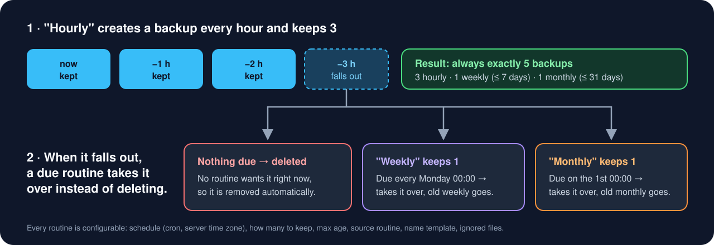
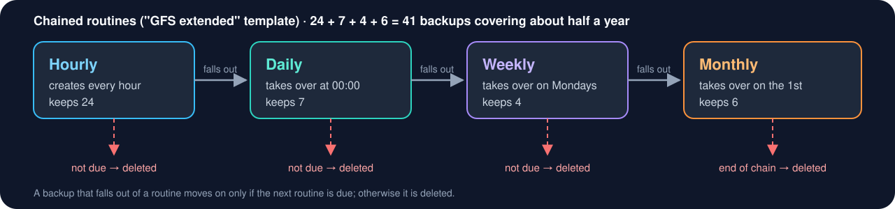

# 💡 Core concepts

[← Guide overview](README.md)

Backup Plus is built around a handful of ideas. Once they click, every setting makes sense.

- [Routines](#routines)
- [Two kinds of routines: create and take over](#two-kinds-of-routines-create-and-take-over)
- [When is a routine "due"?](#when-is-a-routine-due)
- [Rotation: what happens to every backup](#rotation-what-happens-to-every-backup)
- [A day in the life of the default template](#a-day-in-the-life-of-the-default-template)
- [Chains](#chains)
- [Backups that are never touched](#backups-that-are-never-touched)
- [The managed backup group](#the-managed-backup-group)
- [Time zones](#time-zones)

## Routines

A **routine** is one rule of your backup strategy, for example *"make a backup every hour and keep the newest 3"*.
A server can have several routines (10 by default, configurable by the admin). Each routine has:

- a **name** (shown in the UI, the log and backup names),
- a **type**: *create* or *take over*,
- a **schedule** (a cron expression in the server's time zone),
- how many backups to **keep**, and optionally a **maximum age**.

Every backup created by Backup Plus belongs to exactly one routine. The routine decides how long the backup lives.

## Two kinds of routines: create and take over

| Type | What it does on its schedule | Typical use |
| --- | --- | --- |
| **Create a new backup** | Asks the panel to create a fresh backup of the server | "every hour", "every night at 04:00" |
| **Take over a backup from another routine** | Doesn't create anything. It waits until a backup **falls out** of its *source* routine and adopts it instead of letting it be deleted | "keep one per week", "keep one per month" |

Why "take over"? Because a weekly backup doesn't need to be an extra backup. Your hourly routine already produces a
backup every hour — when one of them would be deleted anyway, a weekly routine can simply keep it. That means:

- **no extra load** on the server for weekly/monthly backups,
- **no extra storage** beyond what you decided to keep,
- the weekly backup is always a real, complete backup made a few hours earlier.

## When is a routine "due"?

Each routine has a **next run** time, calculated from its schedule.

- A **create** routine is due when its next run time has passed. Backup Plus then creates a backup and calculates the
  next run.
- A **take over** routine is due when its next run time has passed. It then **stays due** until it has received a
  backup from its source. After receiving one, it calculates its next run.

New routines and routines on a server that has just been switched on start **due immediately**: the first backup is
created within a minute, and take-over routines adopt the first backup that falls out of their source.

> [!NOTE]
> Example: the weekly routine of the default template has the schedule *Monday 00:00*. On Monday at 00:00 it becomes
> due. The next time an hourly backup falls out (shortly after the 01:00 backup completes), the weekly routine takes it
> over and the previous weekly backup is deleted. The weekly routine is then done until next Monday.

## Rotation: what happens to every backup

Rotation runs every time a backup is created and, in addition, every 5 minutes for all servers. For every routine, in
order (sources before the routines that take over from them):

1. **Sort** the routine's successful backups, newest first.
2. **Keep** the newest *N* (the routine's *Keep* value).
3. Everything beyond *N* — or older than the routine's *maximum age* — **falls out**.
4. For each backup that falls out (newest first): is there a **take over** routine with this routine as its source
   that is **due** and hasn't received a backup yet in this pass?
   - **Yes** → the backup **moves** to that routine.
   - **No** → the backup is **deleted**.

The **Managed backups** table on the server page shows the result of this calculation *in advance* for every backup:

| Next action | Meaning |
| --- | --- |
| 🟢 **Stays** | Among the newest backups of its routine |
| 🔵 **Becomes "Weekly"** | Will move to another routine on the next rotation |
| 🔴 **Will be deleted** | Will be removed on the next rotation — hover to see why |
| 📌 **Pinned** | Locked by you, never deleted automatically |
| ⏳ **Running** | Backup is still being created |
| ⚠️ **Failed** | Failed backup that is kept because *delete failed backups* is off |
| ⚪ **Not managed** | Belongs to no active routine and is left alone |

  

## A day in the life of the default template

The **GFS compact** template has three routines: *Hourly* (create, every hour, keep 3), *Weekly* (take over from
Hourly, Mondays, keep 1) and *Monthly* (take over from Hourly, 1st of the month, keep 1).

| Time | What happens | Backups afterwards |
| --- | --- | --- |
| Fri 12:00 | You apply the template. Hourly creates backup **A**. Weekly and Monthly are due right away. | A |
| 13:00, 14:00 | Backups **B** and **C** are created | A B C |
| 15:00 | **D** is created. Once it's finished, A falls out of Hourly → Weekly is due → **A becomes the weekly backup** | B C D · W: A |
| 16:00 | **E** is created. B falls out → Monthly is due → **B becomes the monthly backup** | C D E · W: A · M: B |
| 17:00 | **F** is created. C falls out → nothing is due → **C is deleted** | D E F · W: A · M: B |
| … | Every hour: one new, one deleted. Always 5 backups. | 3 hourly · W · M |
| Mon 00:00 | Weekly becomes due. A few minutes later, when the next hourly backup falls out, it **replaces A** as the weekly backup and A is deleted | 3 hourly · W(new) · M |
| 1st 00:00 | Monthly becomes due and replaces B the same way | 3 hourly · W · M(new) |

When two take-over routines are due at the same time, the one listed first in the editor gets the first backup that
falls out; the next one gets the following backup an hour later.

The result: you always have the last three hours, a weekly backup that is at most about 7 days old, and a monthly
backup that is at most about a month old.

> [!TIP]
> Want a weekly backup that is always **at least** a week old? Set *Keep* of the weekly routine to **2**. Then you
> always have this week's *and* last week's backup.

## Chains

A take-over routine can itself be the source of another routine. This builds a classic
grandfather–father–son (GFS) chain:

  

The **GFS extended** template works like this: 24 hourly → 7 daily → 4 weekly → 6 monthly = 41 backups covering half a
year. Backup Plus checks that a chain always starts at a *create* routine and never loops back on itself.

## Backups that are never touched

Backup Plus is careful about what it deletes. It never deletes:

- **Manual backups** — only backups in its own group are managed.
- **Pinned backups** — use *Pin (never delete)* in the backup's menu. Pinning uses the panel's normal backup lock.
- **Running backups** — a backup that is still being created.
- **Backups of paused routines** — pausing a routine freezes its backups.
- **Backups of deleted routines** — when you remove a routine or apply another template, the backups stay and are shown
  as *Not managed*. Assign them to a routine or delete them yourself.
- **Failed backups**, if you switch off *Delete failed backups automatically*.

## The managed backup group

On first use, Backup Plus creates a backup group named **Backup Plus (auto)** on the server. All automatic backups go
there, so they are clearly separated from manual backups in the panel's normal **Backups** page. The group has the
panel's own retention switched off — Backup Plus is the only thing that rotates it. If you delete the group, Backup Plus
creates a new one on the next run.

## Time zones

Schedules are evaluated in the **server's time zone** (the time zone set for the server in the panel). If the server
has none, UTC is used. The routine editor shows the time zone next to the schedule, and the *next run* preview uses it
too. Daylight-saving changes are handled automatically.

---

[← Getting started](getting-started.md) · Next: [Routine reference →](routines.md)
